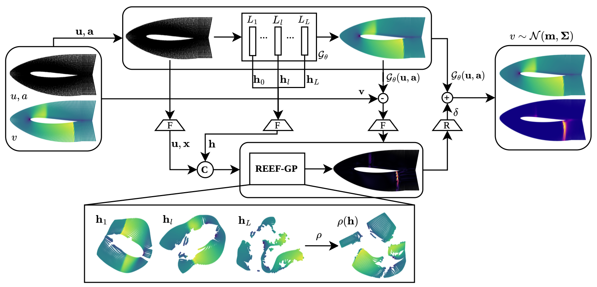
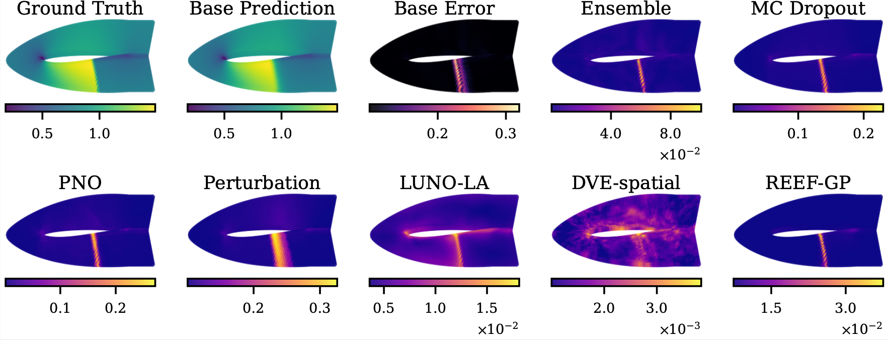
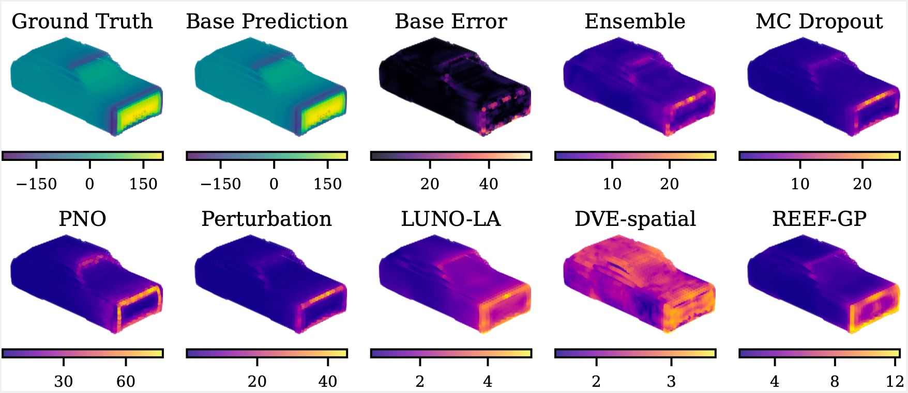
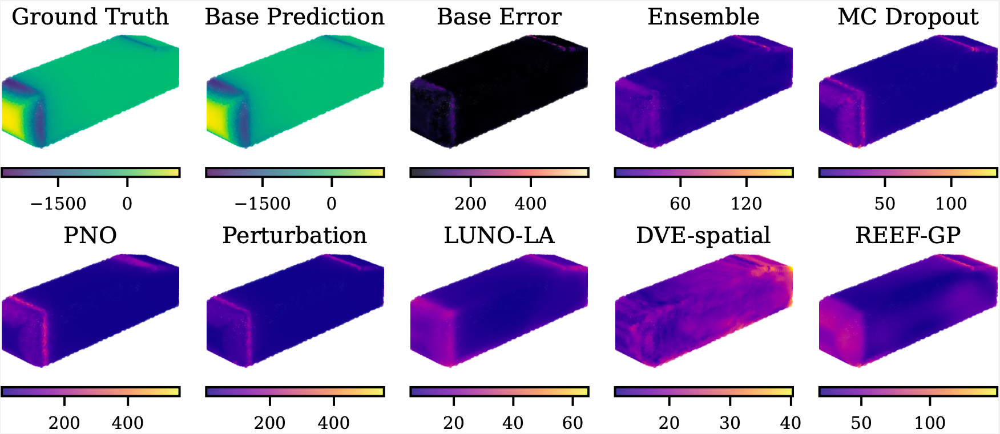

# Geometry-Aware Post-Hoc Uncertainty Quantification in Operator Learning

[[Paper]](https://arxiv.org/abs/2606.17513) · [[Citation]](#citation)

This repository is the official implementation of **REEF-GP**, from the paper *Geometry-Aware Post-Hoc Uncertainty Quantification in Operator Learning* (NeurIPS 2026).

REEF-GP adds uncertainty estimates to a pretrained neural operator without retraining it. It fits a Gaussian process to the residuals of the frozen operator, with a kernel built on its internal latent features. The layers are selected with CKA, and the noise model is heteroscedastic.



## Code Structure

| Path | Description |
|------|-------------|
| `olgp/gpp/` | Base GP code: kernels, constraints and configuration |
| `olgp/uq/` | UQ methods: REEF-GP (`uq_ours.py`), deep ensembles, MC Dropout, Laplace, PNO, input perturbation |
| `olgp/baselines/` | Transolver backbone trainer and evaluator |
| `olgp/preprocessing/` | Per-dataset preprocessing (Elasticity, NACA, Pipe, Car, Ahmed) and MMD OOD scores |
| `olgp/compare_results.py` | Collects the results of all UQ methods into tables and comparison figures |
| `configs/` | Hydra configs: `problem/` for datasets, `ablation/` for backbone variants |
| `scripts/linux/` | Shell scripts to run preprocessing, training and evaluation |
| `assets/` | Figures used in this README |

## Requirements

A CUDA GPU is required (`settings.device: "cuda"` in `./configs/config_transolver.yaml`). The code was tested with Python 3.10 and CUDA 12.1. To install the requirements:

```bash
pip install -r requirements.txt
```

## Setup

Set the repository path used to read the data and store the outputs by running, from the repository root:

```bash
bash scripts/fix_paths.sh
```

Alternatively, replace the `<ROOT_FOLDER>` placeholders by hand in `./configs/machine/local.yaml` and in the shell scripts in `./scripts/linux`. `<ROOT_FOLDER>/reefgp` and `<ROOT_FOLDER>` both stand for the absolute path of this repository.

## Datasets

Download the original datasets into `./Data/<DATASET_NAME>`, i.e. `./Data/Elasticity`, `./Data/Naca`, `./Data/Pipe`, `./Data/Car` and `./Data/Ahmed`:

| Dataset        | Source |
| -------------- | ------ |
| Elasticity     | [Google Drive](https://drive.google.com/drive/folders/1YBuaoTdOSr_qzaow-G-iwvbUI7fiUzu8) |
| Airfoil (NACA) | [Google Drive](https://drive.google.com/drive/folders/1YBuaoTdOSr_qzaow-G-iwvbUI7fiUzu8) |
| Pipe           | [Google Drive](https://drive.google.com/drive/folders/1YBuaoTdOSr_qzaow-G-iwvbUI7fiUzu8) |
| ShapeNet Car   | [Data](http://www.nobuyuki-umetani.com/publication/mlcfd_data.zip) ([Umetani & Bickel, 2018](https://dl.acm.org/doi/pdf/10.1145/3197517.3201325)) |
| Ahmed Body     | [Google Drive](https://drive.google.com/drive/folders/1YBuaoTdOSr_qzaow-G-iwvbUI7fiUzu8) |

## Pipeline

The full pipeline for one dataset is:

1. Preprocess the raw data.
2. (Optional) Compute the geometry OOD scores.
3. Train and evaluate the Transolver backbone.
4. Fit REEF-GP and the UQ baselines on the frozen backbone.
5. Collect the results into tables and figures.

In the commands below, `<DATASET_NAME>` is the lowercase config name: `elasticity`, `naca`, `pipe`, `car` or `ahmed`.

### Seeds

All results are reported over 5 seeds, and the UQ methods load the pretrained backbones of seeds 0–4. Steps 1–3 must therefore be run once per seed by adding `settings.random_seed=<SEED>`, e.g.:

```bash
for s in 0 1 2 3 4; do ./scripts/linux/transolver/run_preprocess.sh problem="transolver/naca" settings.random_seed=$s; done
```

### 1. Preprocessing

```bash
./scripts/linux/transolver/run_preprocess.sh problem="transolver/<DATASET_NAME>"
```

### 2. Geometry OOD scores (optional)

To reproduce the OOD analysis (metrics per geometry-novelty quartile Q1–Q4), compute the MMD distance of each test geometry to the training set:

```bash
./scripts/linux/transolver/run_mmd.sh problem="transolver/<DATASET_NAME>"
```

This writes `<DATASET_NAME>_data_mmd.pt` next to the preprocessed data. If the file is missing, the UQ evaluation still runs and skips the per-quartile metrics.

### 3. Training the Transolver backbone

```bash
./scripts/linux/transolver/run_train.sh problem="transolver/<DATASET_NAME>"
./scripts/linux/transolver/run_eval.sh problem="transolver/<DATASET_NAME>"
```

Outputs are stored in `./Out`, and configurations are in `./configs`.

The MC Dropout and PNO baselines need their own backbones, trained with dropout:

```bash
./scripts/linux/transolver/run_train.sh problem="transolver/<DATASET_NAME>" ablation="dropout" problem.model.dropout=0.1
./scripts/linux/transolver/run_train.sh problem="transolver/<DATASET_NAME>" ablation="pno" problem.model.dropout=0.1
```

### 4. Running REEF-GP and the UQ baselines

To fit and evaluate REEF-GP on a pretrained backbone:

```bash
PYTHONPATH=. python olgp/uq/uq_ours.py --config-name config_transolver problem.uq.fit=True problem.uq.aggregation="gpoe" problem="transolver/<DATASET_NAME>"
```

`./scripts/linux/run.sh` runs this command for all five datasets. Comment out the datasets you do not need.

The UQ baselines are listed in `./scripts/linux/run_baselines.sh`. By default it runs the deep ensemble on all datasets; uncomment the lines of the other baselines (MC Dropout, PNO, Laplace, input perturbation) to run them:

```bash
./scripts/linux/run_baselines.sh
```

### 5. Comparing methods

Collect the results of all methods into tables (mean ± std over seeds, in Markdown and LaTeX) and figures comparing the predicted uncertainty of every method:

```bash
python olgp/compare_results.py --problems naca car
```

Methods that were not run are skipped. Everything is saved to `./Out/Baselines/transolver/Comparison`. If the MMD scores were computed, a table of metrics per geometry-novelty quartile (Q1–Q4) is also generated.

## Results

Predicted uncertainty of REEF-GP and the baselines on test samples.

**Airfoil**



**ShapeNet Car** (Q4, the most out-of-distribution test geometries)



**Ahmed Body**



**Reproducibility.** Rerunning the pipeline reproduces the reported metrics within their standard deviation over seeds. The results are not bit-identical, because some GPU operations used in training are nondeterministic.

## Acknowledgement

We thank the authors of the following open-source repositories, which we used as the basis for some of the experiments:

- [Transolver](https://github.com/thuml/Transolver)
- [Laplace Redux](https://github.com/runame/laplace-redux)

## Citation

If you find this code useful, please cite our paper:

```bibtex
@misc{vendrellgallart2026geometryawareposthocuncertaintyquantification,
      title={Geometry-Aware Post-Hoc Uncertainty Quantification in Operator Learning},
      author={Oriol Vendrell-Gallart and Nima Negarandeh and Ramin Bostanabad},
      year={2026},
      eprint={2606.17513},
      archivePrefix={arXiv},
      primaryClass={cs.LG},
      url={https://arxiv.org/abs/2606.17513},
}
```

## License

This project is released under the MIT License. See [LICENSE](./LICENSE) for details.
